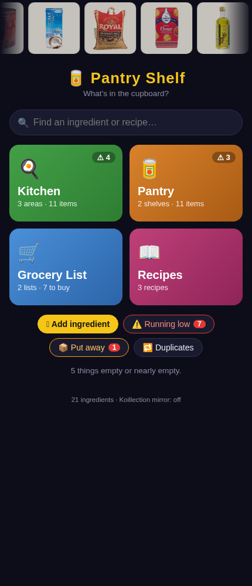

# pantry-shelf

A home web app for keeping track of food: what's in the kitchen and the
pantry, exactly where it lives, how full it is, what needs restocking, the
grocery lists to restock it, and a recipe book that knows what you have.
It's a sibling of [movie-shelf](../movie-shelf), with the same look,
and mirrors its ingredients into a Koillection **"Pantry"** collection.

Runs on the Pi, served at **http://\<pi-ip\>:5010**.



## Features

### Home
- A scrolling banner of ingredient pictures (tap one to open it).
- **Search** for any ingredient or recipe. Each result shows where it lives
  and how full each spot is. If nothing matches, you can add it from there.
- Big buttons: **Kitchen**, **Pantry**, **Grocery List**, **Recipes**, with
  warning counts for anything running low.
- Quick buttons: **+ Add ingredient**, **Running low**, **Put away**, **Duplicates**.

### Kitchen: areas › shelves › ingredients
- **Areas** (spice drawer, upper cupboard, counter…) are picture cards. Each
  uses its own photo, or an emoji if it has none, and doesn't show the
  ingredients inside. **Edit areas** creates, renames, re-pictures, reorders
  and deletes them.
- Tapping an area zooms into it. Each **shelf** is drawn as a wooden plank
  with its name, a subtitle describing what it holds, and a preview of the
  ingredient pictures sitting on it. Tap a shelf to open it and see
  everything. **Edit shelves** manages them.

### Pantry: shelves › (optional) bins › ingredients
- Each shelf is a plank holding **bins** (cardboard boxes that show a 2×2
  sample of what's inside) and/or loose ingredients. Tap a bin to zoom in.
- **Archived** (top of the Pantry) lists ingredients you've hidden because
  you don't plan to restock them. Restore them from there.

### Ingredients
- Tapping any ingredient opens its card, with **Kitchen** and **Pantry**
  sections. An ingredient can be in both, or in several spots in one space:
  - where it lives (change it with a drop-down)
  - a 0–10 level meter (tap a segment), plus **Full** / **Empty** buttons
  - container type and size; for the pantry, refill quantity and price to replace
- **Add to grocery list**, **Archive**, **Edit details** (name, brand, category,
  description, notes, picture), **Delete**.
- **Purchase history**: every time it was bought, how much, the price, the days
  between purchases, and how often you usually buy it. Ticking it off a grocery
  list logs a purchase automatically; you can also log one by hand.
- **Used in recipes**: every saved recipe that calls for it.
- Anything at 20% or less is outlined amber; 10% or less is red, and
  empty ones are greyed out.

### Adding an ingredient
A three-step wizard:
1. **Find it**: type a name. It checks what you already have (so you don't add
   duplicates) and searches two free databases:
   - [TheMealDB](https://www.themealdb.com/) ingredient list: ~600 generic
     ingredients, each with a clean product photo and a short description.
   - [Open Food Facts](https://world.openfoodfacts.org/): packaged products
     with brands, sizes and front-of-pack photos (good Canadian and Kirkland coverage).
   Or just use the name as typed.
2. **Details & picture**: check the name, brand, category and description,
   then choose a picture from the search results, upload or take a photo, or
   paste an image URL.
3. **Where it lives**: kitchen spot, pantry spot, both or neither, each with a
   container, a fill level and (for the pantry) a refill quantity and price.

Opening the wizard from inside a shelf or bin pre-selects that spot.

### Running low
Everything at or below 20%, split into **Empty**, **10% or less** and **20%
or less**, with a filter for Everywhere / Kitchen / Pantry. Each item has an
add-to-list button and a Full button, and each section has **Add all to a list**.

### Grocery lists
- A checklist per list. Add things by hand (autocompletes your ingredients),
  from an ingredient card, from Running Low, or from a recipe. Items show
  where they came from (pantry / kitchen / recipe) and where they live.
- **New list**: name it, or leave it blank and it's named after the date. You
  can also give it a store. The creation date is always kept.
- **Pinned lists** are for staples. They stay at the top, never finish, and have
  **Uncheck all for next trip**.
- **Done shopping** moves a list to **Finished lists** (a button at the bottom
  of the Grocery page), where you can look back at past trips.
- Ticking off a tracked ingredient, or finishing a list, asks whether to add it to…

### Put away
Lists what you bought and where each item lives (every spot). **Put away**
sets that spot back to full. Items without a home get a drop-down to choose one.

### Duplicates
- **Same thing, several spots**: one ingredient in two spots of the same
  space. **Combine here** pours the others into one (levels add up).
- **Similar names**: separately added ingredients that look like the same
  thing ("Flour" / "flours"). **Keep this one** merges the others into it,
  moving their stock, purchase history, grocery entries and recipe links.

### Recipes
- **Add**: import from a URL (uses [recipe-scrapers](https://github.com/hhursev/recipe-scrapers),
  which covers hundreds of sites plus any page with schema.org recipe data),
  **browse** TheMealDB's free recipe collection, **paste** a recipe's text, or
  type one in. Imports open in an editor so you can tidy the ingredients and
  directions before saving.
- Some big sites (Allrecipes, Serious Eats, Budget Bytes…) block automated
  imports. For those, copy the recipe in your browser and use **Paste recipe text**.
- A **recipe book** with 1–5 star ratings, collections (Breakfast, Lunch,
  Dinner, Dessert, Salad, Appetizer, Snack, Drinks; add or rename your own
  with ⚙️), filtering, and sorting by name, rating, date added or *fewest missing*.
- In a recipe, each ingredient line is coloured by what you have:
  **green** in stock, **amber** low, **red** out, grey not tracked. Lines are
  matched to your ingredients automatically ("2 cups brown sugar" → Brown
  Sugar, "100g flour" → Plain Flour); tap 🔗 to fix a match or mark a line
  untracked. **Select missing** → **Add to list** sends what you're short of
  to a grocery list. Tap a direction step to cross it off while cooking.

## Where things are stored

| What | Where |
|---|---|
| Everything (locations, ingredients, stock, lists, put-away, purchases, recipes) | `data/pantry.db` (SQLite) |
| Ingredient, location and recipe pictures (≤600px) | `data/images/` |
| Koillection mirror of each ingredient | the **Pantry** collection in Koillection |

`data/` is mounted into the container, so it survives rebuilds. Back it
up by copying the folder.

### Koillection mirror
Koillection isn't a great fit as the database here: levels change daily,
and lists, purchase logs and recipe links don't map onto it. Fetching item
fields one by one would also make every screen slow. So the app's own SQLite
file is the source of truth, and each ingredient is pushed (in the
background) to a Koillection **Pantry** collection as an item with its
picture and these text fields:

`Category`, `Brand`, `Kitchen Location`, `Kitchen Level`, `Pantry Location`,
`Pantry Level`, `Container`, `Status` (Stocked / Needs restock / Archived), `Description`.

It's one-way: edits made in Koillection are overwritten the next time that
ingredient changes here. Deleting or merging an ingredient deletes its
Koillection item. The home screen footer shows the mirror's status. To push
everything again, run `curl -X POST http://localhost:5010/api/koillection/resync`.
Turn it off with `KOI_MIRROR=0`. Credentials come from `KOILLECTION_*`
environment variables or koicli's `~/.config/koicli/config.toml` (shared
with movie-shelf).

## Architecture

```
app.py            Flask routes (thin)
store.py          Business logic: snapshot, locations, ingredients/stock, lists, put-away, recipes, duplicates
db.py             SQLite schema + connection helpers
sources.py        TheMealDB / Open Food Facts lookups, image download+resize, recipe import/paste, line matching
koi_mirror.py     Background one-way push to Koillection
koillection_client.py  Koillection REST client (copied from movie-shelf)
static/
  index.html      Shell
  style.css       movie-shelf palette + shelf/bin visuals
  core.js         State, router, modals, toasts, home, search
  places.js       Kitchen / Pantry / bins, location editor
  ingredient.js   Ingredient card, add wizard, image picker, add-to-grocery
  lists.js        Running low, put away, duplicates, grocery lists
  recipes.js      Recipe book, import/browse/paste, editor
```

The browser loads everything once from `/api/snapshot` (a home pantry is
small) and reloads it after each change, and every minute so a list ticked
on one phone shows up on another. There's no login: like most of the Pi's
apps, it's meant for the home network.

## Installation

```bash
cd /home/pi/Scripts/pantry-shelf
docker compose up -d --build
```

`static/` is mounted read-only, so UI edits only need a browser refresh.
Python changes need `docker compose up -d --build`.
